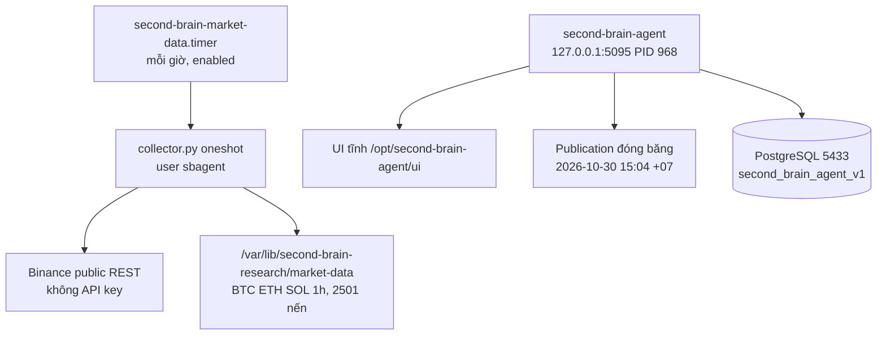

# Second Brain và Agent Trading — kiểm tra thực trạng VPS B

Thời điểm đọc: 2026-11-04 23:25–23:32 +07.  
Máy: `157.10.53.182`, hostname `interdata.1793262774`.  
Cách làm: chỉ đọc process, unit, log, file và `SELECT`. Không login (login sẽ ghi session), không migration, không ghi dữ liệu, không restart, không gọi sàn, không mở VPS A.

Không có socket tới `103.200.23.229`.

## 1. Executive Summary

Trên VPS B đang có hai mặt phẳng tách nhau.

Mặt phẳng nến thì đang làm việc. Timer `second-brain-market-data.timer` bắn mỗi giờ. Lần gần nhất 2026-11-04 22:33:07 +07 thoát mã 0. Ba cặp BTCUSDT, ETHUSDT, SOLUSDT, khung 1 giờ, mỗi cặp 2 501 nến liền mạch từ 2026-07-23 10:00 UTC đến 2026-11-04 14:00 UTC. Nguồn là REST công khai của Binance. `live_orders=false`, `exchange_orders_sent=0`. Không có API key trong unit.

Mặt phẳng Second Brain thì process web đang sống và gần như nghỉ. `second-brain-agent` PID 968, nghe `127.0.0.1:5095`, health HTTP 200, `workerEnabled=false`. Database `second_brain_agent_v1` trên cổng 5433. Dữ liệu vòng lặp cuối cùng là 2026-10-30 10:00:43 +07, toàn bộ là fixture do người kích hoạt. Không có task, không có memory, không có agent, không có phiên đăng nhập còn hiệu lực. Publication nghiên cứu là năm file JSON đóng băng lúc 2026-10-30 15:04 +07. File đó không được collector cập nhật.

Không có Trading Agent. Không có process chiến lược, không có bảng tín hiệu, không có sổ vị thế, không có risk engine đang chạy, không có báo cáo hiệu quả được tính lại sau ngày 30/10. Các số trong publication là kết quả một lần chạy ở quá khứ, và chính file ghi `NOT_A_PERFORMANCE_CLAIM`, `selected_strategy=null`, `EXPERIMENT_NOT_APPROVED`.

**Second Brain:** chưa giao được một việc thực tế để máy tự gọi công cụ và trả kết quả có kiểm chứng. Host nhận request HTTP, từ chối khi chưa đăng nhập, và giữ ba vòng fixture cũ. Worker tắt. Không có phiên sống.

**Agent Trading:** chưa có hệ thống nghiên cứu và giao dịch mô phỏng đủ để đánh giá chiến lược theo thời gian. Phần đang chạy là bộ thu nến. Phần đánh giá là một publication đóng băng, không nối với nến mới, và không chọn chiến lược nào.

## 2. Kiến trúc đang chạy

Không có mũi tên từ archive nến sang host, sang publication, hay sang database. `market_snapshot` trong DB có 0 dòng. Không có strategy runner, signal worker, paper worker, risk engine, hàng đợi, hay khóa model LLM trong môi trường đang chạy.

Nginx không có `5095` và không có `second-brain`. Host chỉ nghe loopback.

## 3. Service, process, database

Đo lúc 2026-11-04 23:27 +07. Uptime máy 1 ngày 2 giờ. Load 0.09. 5 CPU. RAM 7 941 MB, dùng 871 MB, còn khoảng 7 069 MB. Đĩa `/` 69 GB, dùng 9.4 GB, còn 56 GB, 15%. Không swap.

### Đang chạy liên tục

| Thành phần | Trạng thái | Ghi chú |
|---|---|---|
| `second-brain-agent.service` | active, enabled, PID 968, user `sbagent` | Start sau boot 2026-11-03 21:27:22 +07. `NRestarts=0`. RAM khoảng 93 MB. CPU tích lũy khoảng 16 giây |
| `second-brain-market-data.timer` | active, enabled, waiting | `OnBootSec=2min`, `OnUnitActiveSec=1h`. Lần bắn cuối 22:33:07 +07. Lần kế 23:33:07 +07, chưa tới lúc đọc 23:32 |
| `postgresql@16-sbagent` | active, `127.0.0.1:5433` | Database Second Brain |
| `postgresql@16-main` | active, `127.0.0.1:5432` | Không chứa schema personal/trading/brain/research |
| `nginx` | active, cổng 80 | Không proxy Second Brain |

Cùng máy còn `kit-platform-api` (`127.0.0.1:5000`), `kit-platform-w5` (`127.0.0.1:5291`) và SMS stub. Đây không phải Second Brain hay Trading. Lần này không đọc dòng dữ liệu của các database đó.

### Có unit nhưng không phải process thường trú

| Unit | Trạng thái |
|---|---|
| `second-brain-market-data.service` | oneshot, inactive sau khi chạy. Lần cuối 22:33:07–22:33:08 +07, exit 0. Journal từ 2026-11-02: 0 lần failed |

Không có cron khớp `second-brain`, `market-data`, `trading`. Không có Redis, RabbitMQ, hay process Python chiến lược. Process Python còn lại là SMS stub và unattended-upgrades.

### Database

Cổng 5433, system identifier `7702079316921501630`:

| Database | Kích thước |
|---|---|
| `second_brain_agent_v1` | 10 MB |
| `postgres` | 7.5 MB |

Schema người dùng: `public`, `second_brain_host`, `pack_personal_intelligence`. Extension `pgcrypto`. Foreign server 0. Subscription 0. Role `sb_agent` là login, không superuser. Role này có SELECT, INSERT, UPDATE trên 38 bảng và DELETE, TRUNCATE, REFERENCES, TRIGGER trên 37 bảng.

Cổng 5432, chỉ liệt kê tên:

| Database | Kích thước |
|---|---|
| `kit_platform_staging` | 34 MB |
| `novixa_prod` | 28 MB |
| `novixa_w5_staging` | 25 MB |
| `postgres` | 7.5 MB |

Không có database `trading_research` hay `trading_agent`. Ba database ứng dụng trên 5432 không có schema khớp `personal`, `trad`, `brain`, `research`, `market`. Nến không nằm trong Postgres.

### Mã đang chạy

Không có thư mục `.git` dưới `/opt`, `/var/lib`, `/srv`, `/home`, `/root`.

Process đang chạy:

`/usr/bin/dotnet /opt/second-brain-agent-v1-9d28227/host/KitPlatform.SecondBrainAgent.Host.dll`

SHA-256 host DLL: `f8d87d61d4fd0abea12a08a58dbc1d43fb90f4e9f3df6c801f665ec01c375f3f`  
Mtime 2026-10-30 15:51:29 +07, 99 840 byte. Working directory đúng thư mục đó. Drop-in `/etc/systemd/system/second-brain-agent.service.d/v1-session-security.conf` ghi đè `ExecStart` của unit gốc.

Trên đĩa còn các bản không được process dùng: `/opt/second-brain-agent`, `second-brain-agent-candidate`, `v1-2c1ea353`, `v1-5f29e1bd`, `v1-session-security`. Thư mục đang chạy có `KitPlatform.Packs.Pharmacy.Application.dll`, nhưng health chỉ có hai hosted service: DataProtection và GenericWebHost. Không có worker Pharmacy.

Env `/etc/second-brain-agent/agent.env`, mode `600`, owner root. Các giá trị đã đọc, không gồm bí mật:

| Khóa | Giá trị đã thấy |
|---|---|
| `ASPNETCORE_ENVIRONMENT` | `Production` |
| `ASPNETCORE_URLS` | `http://127.0.0.1:5095` |
| `ConnectionStrings__Default` | Host `127.0.0.1`, Port `5433`, Database `second_brain_agent_v1`, Username `sb_agent`. Có trường mật khẩu. Giá trị không được ghi ra |
| `PersonalIntelligence__ExchangeBackfill__WorkerEnabled` | `false` |
| `PersonalIntelligence__ResearchPublication__Root` | `/opt/second-brain-research-publication-v1` |
| `SecondBrain__WebRoot` | `/opt/second-brain-agent/ui` |
| `SecondBrain__SystemIdentifier` | `7702079316921501630` |

Có khóa JWT và mật khẩu bootstrap. Không có khóa model LLM, không có khóa Binance hay Bybit. Không in độ dài hay giá trị.

## 4. Năng lực Second Brain

Nhãn: **VERIFIED** đã đọc được bằng chứng việc đã xảy ra. **RUNNING** process sống nhưng chưa chứng minh kết quả mới. **PARTIAL** có một mảnh. **CODE_ONLY** có route hoặc schema, chưa có lần chạy chứng minh. **NOT_FOUND** không có.

| Năng lực | Nhãn | Bằng chứng trên VPS B |
|---|---|---|
| Context / memory | PARTIAL | `pi_context` 3 dòng, cả ba summary là `Fixture trading context`, source `FIXTURE`. `pi_evidence` 3. `pi_experience` 3. `pi_memory` 0. `pi_knowledge` 0. Chưa gọi API truy xuất vì login sẽ ghi session |
| Task | PARTIAL | Bảng `pi_task` có, 0 dòng. `GET /api/personal-intelligence/tasks` trả 401 |
| Điều phối agent | PARTIAL | 3 operation ngày 29–30/10, `actor_type=HUMAN`, `Autonomy=recommend_only`. `pi_agent` 0 dòng. Worker tắt. Không có orchestrator đang chạy |
| Gọi công cụ | PARTIAL | 0 dòng `pi_action`. Ba receipt JSON lưu trong `pi_operation`, giá 100, symbol BTCUSDT, không phải kết quả công cụ bên ngoài. Không có process tool |
| Execution trace | VERIFIED | 18 `pi_events`, sáu loại, mỗi loại 3, source `operational-loop`, actor `HUMAN`, từ 2026-10-29 20:23:58 +07 đến 2026-10-30 10:00:43 +07. Khớp 3 operation. Không có event nào sau đó |
| Tự làm một workflow | CODE_ONLY | Route intent và trading loop có mặt và trả 401. Không có model trong env. Không có task. Không có lịch. Không có phiên sống. Ba vòng cũ là người bấm, một lần, `recommend_only` |

Health lúc 23:30:27 +07:

`status=ok`, `database=second_brain_agent_v1`, `workerEnabled=false`, `backfillWorkerRegistered=false`.  
`/api/health/db` HTTP 200, `value=1`.  
`GET /` HTTP 200. Mười bốn route personal-intelligence đều 401.

UI đang phục vụ từ `/opt/second-brain-agent/ui/index.html`, 409 byte, SHA-256 `e8c8c387c1c8b15d6b8aa3cc5ea77348dc1951428768a506e372f46b0b058a76`, script `/assets/index-CAMJg88Q.js` (1 307 757 byte). Trong file JS có các chuỗi `So sánh evaluation`, `Đây là chiếu publication`, `NOT_A_PERFORMANCE_CLAIM`. UI là màn hình đọc publication, không phải nơi agent đang làm việc.

Journal `second-brain-agent` từ boot 2026-11-03: 5 dòng, toàn systemd stop/start. Không có exception ứng dụng.

### Vòng duy nhất truy được

`ACCEPTANCE-20261030-paper`, 2026-10-30 10:00:43 +07.

- Operation: `recommend_only`, BTCUSDT, BUY.
- Decision: `ACCEPTANCE-20261030 paper proposal fixture`, status `accepted`.
- Outcome: `Đã ghi giả lập. Không gửi lệnh lên sàn.`
- Order: BTCUSDT BUY, status `paper`, source `paper`, cùng thời điểm.
- Execution: mode `PAPER`, cùng thời điểm.
- Context: `Fixture trading context`.
- Không có dòng `pi_task`, không có `pi_action`, không có kết nối sàn.

Hai vòng kia cùng dạng. `paper-b` cũng ghi giả lập và không gửi lệnh. `candidate-review` có decision `proposed` và outcome `Chưa ghi giả lập. Giả lập cần một bước phê duyệt riêng.` Không có order paper cho vòng đó.

Danh tính trong DB: tenant `SECOND_BRAIN`, user `sb-operator`, status 1, `last_login_at` trống. Person `Paper operator`. Exchange code `PAPER`. Account `Paper fixture`, status `active`, `account_type` trống. Quyền trên operator: `trading.run`, `trading.approve`, `research.read`, `exchange.read`. Catalog `public.permissions` chỉ có `exchange.connect` và `exchange.read`.

Session: 4 dòng, cả 4 đã revoke. Tạo từ 2026-10-30 12:34 đến 15:58 +07. 0 session còn hạn. Refresh token: 12 dòng, 9 đã revoke, 3 còn hạn đến 2026-11-06 và cả 3 có `session_id` null. Không in hash.

`exchange_connection`: 0 dòng, 0 ciphertext. `exchange_backfill_job`: 0. `exchange_account_snapshot`: 0.

## 5. Năng lực Agent Trading

Chuỗi yêu cầu: Market Data, Storage, Strategy, Signal, Evaluation, Risk, Paper Trading, Reporting.

| Khâu | Nhãn | Thực tế |
|---|---|---|
| Market Data Collector | VERIFIED | Timer mỗi giờ, exit 0, 0 lỗi từ 2026-11-02. Ba cặp, 1h, nến đóng, REST công khai |
| Data storage | VERIFIED | File `candles.jsonl` + `manifest.json`. 2 501 dòng khớp manifest, 0 khoảng trống 1 giờ, nến cuối khớp manifest. Không nằm trong DB |
| Strategy research | PARTIAL | Kết quả đóng băng trong publication. Không tìm thấy mã strategy, backtest, signal hay `trading_agent` trên `/opt`, `/var/lib`, `/usr/local`, `/home` |
| Strategy evaluation | PARTIAL | `LAB_RESULT.json` có số dev/out-of-sample. File tự ghi không đủ chứng cứ, không phải performance claim, `selected_strategy` null. Không có service đánh giá |
| Signal | PARTIAL | Số LONG/SHORT/NO_TRADE chỉ nằm trong file lab ngày 30/10. Không có bảng signal. Đợt paper sau đó: 0 lệnh giả lập |
| Risk control | PARTIAL | Publication: vốn giả định 100 USD, `risk_limits_approval=PROPOSED_NOT_APPROVED`. Không có process giới hạn vốn hay chặn lệnh |
| Paper trading | PARTIAL | 2 execution `PAPER` ngày 29–30/10, 2 order `paper`, 3 trade `IMPORT`/`FIXTURE`, 0 position, 0 fee, 0 market snapshot. Không đọc archive nến |
| Reporting | PARTIAL | `PAPER_RESEARCH_REPORT.json` đóng băng, `report_kind=PAPER_EXTENSION_NOT_A_SELECTION`. API report trả 401. Không được tính lại sau 30/10 |
| Trading Agent hoàn chỉnh | NOT_FOUND | Không có chuỗi dữ liệu mới thành tín hiệu, thành sổ giả lập, thành báo cáo sau phí |

### Nến, đo trực tiếp

Archive `/var/lib/second-brain-research/market-data`, khoảng 2.7 MB. `symbols.json` khai báo SOLUSDT, BTCUSDT, ETHUSDT, interval `1h`, `history_start_ms=1784800800000`, source `BINANCE_PUBLIC_REST`.

| Cặp | Dòng | Manifest | Gap 1h | Nến đầu | Nến cuối | Cập nhật |
|---|---|---|---|---|---|---|
| BTCUSDT | 2501 | 2501 | 0 | 2026-07-23 10:00 UTC | 2026-11-04 14:00 UTC | 2026-11-04 15:33:08 UTC |
| ETHUSDT | 2501 | 2501 | 0 | cùng mốc | cùng mốc | 15:33:08 UTC |
| SOLUSDT | 2501 | 2501 | 0 | cùng mốc | cùng mốc | 15:33:08 UTC |

`health.json` gốc: `status=OK`, `live_orders=false`, `exchange_orders_sent=0`, `checked_at=2026-11-04T15:33:08.639441Z`.

Log `/var/log/second-brain-market-data/collector.log`: 178 dòng, 93 094 byte, dòng cuối cùng timestamp với ba lần insert lúc 15:33:08 UTC. Các giờ trước trong cùng ngày cũng insert đúng 1 nến, `conflicts=0`, `gap_count=0`, `age_ms=0`. SOL có 66 dòng `runs.jsonl`, BTC và ETH có 59. Lần đọc 23:32 +07 chưa tới nhịp 23:33, nên nến 15:00 UTC chưa được kéo. Độ trễ này khớp timer một giờ và rule chỉ lấy nến đã đóng.

Unit không có khóa API. Lệnh là `python3 /opt/second-brain-market-data/collector.py --archive /var/lib/second-brain-research/market-data sync`.

### Publication nghiên cứu, không phải agent

Thư mục `/opt/second-brain-research-publication-v1`, mtime 2026-10-30 15:04:30 +07. SHA-256 từng file khớp trường trong `manifest.json`.

| File | SHA-256 |
|---|---|
| `manifest.json` | `cf0661e9a64f2a40ded3202b9a1dca4621839a5be44b45b0aed57f969095c578` |
| `lab/LAB_RESULT.json` | `8f19e6e010999637fe2b1b793106ea2c22b5def60e06fbb8b06dcb6267d5714b` |
| `paper/PAPER_OPS_STATUS.json` | `0cdecbb0e7b2a5f8430cd32d713aaf5be447096272a273cb72e62b0f32bc84b5` |
| `paper/PAPER_RESEARCH_REPORT.json` | `84b67af769b13ff13eae823f07446de682334f03fff2b7643a6069f2b83f549f` |
| `paper/PAPER_OPS_HEALTH.json` | `d4e557a3510047b127cd9ff1b714a63dd9030b115e0a25399fa27d26b4fab6ab` |

`publicationId=pub-e65b6912e02a168d`. `selected_strategy=null`. `approval_status=EXPERIMENT_NOT_APPROVED`. `evidence_status=INSUFFICIENT_EVIDENCE`. `paper_status=NO_NEW_CLOSED_BAR`. `paper_new_bars=0`. `continuous_schedule=NOT_VERIFIED_OPERATOR_RUN_ONLY`. `live_orders=false`. `exchange_orders_sent=0`.

Số trong lab, đúng như file đang nằm trên đĩa. Đây là mẫu quan sát đã đóng băng, không phải kết quả đang được tính, và file ghi `NOT_A_PERFORMANCE_CLAIM` trên từng thí nghiệm.

| Thí nghiệm | Lệnh mẫu dev | Net dev | Lệnh ngoài mẫu | Net ngoài mẫu |
|---|---|---|---|---|
| `EXP-TREND-SMA-10-30-V1` | 25 | +7.172 | 17 | −3.066 |
| `EXP-BREAKOUT-DONCHIAN-20-V1` | 38 | +6.265 | 16 | −1.564 |
| `EXP-REVERSION-RANGE-20-V1` | 35 | −3.576 | 14 | −1.929 |

Phí trong file là giả định `0.0005`, slippage giả định `0.0001`, `fee_status=ASSUMPTION_NOT_ACCOUNT_SCHEDULE`. Không có biểu phí tài khoản.

Đợt paper `PAPER_OPS_STATUS.json`: `runner_status=SUCCEEDED`, `cycle_outcome=PAPER_SIMULATED`, `last_run_at=2026-10-30T04:04:02Z`, `mode=ONCE`, `capital_usd=100`, `risk_limits_approval=PROPOSED_NOT_APPROVED`, `exchange_orders_sent=0`. Report phủ SOLUSDT 1h từ 2026-10-21 09:00 UTC đến 2026-10-30 03:00 UTC, 211 nến. Cả ba thí nghiệm: `simulated_entries=0`, `closed_trades=0`, `open_trades=0`, net pnl `NOT_REPORTED_SAMPLE_TOO_SMALL`.

Nến archive đã đi tiếp đến 2026-11-04 14:00 UTC. Publication không đổi từ 15:04 +07 ngày 30/10. Hai bên không ăn nhau.

Sổ DB không phải sổ của publication. Ba trade là `IMPORT` / `FIXTURE`, BTCUSDT BUY, cùng một `executed_at` 2026-10-01 07:00 +07, phí trống. Position 0. Fee 0. Funding 0. Snapshot thị trường trong DB 0.

## 6. Bằng chứng đã đọc

| Lúc +07 | Việc đọc | Kết quả |
|---|---|---|
| 23:25:07 | hostname, date, socket tới VPS A | `interdata.1793262774`. Không có socket |
| 23:27:22 | CPU, RAM, disk, unit, timer, listen | Số ở mục 3. PID 968. Timer market-data enabled |
| 23:27 | Health và DB health | HTTP 200. Worker false. DB đúng tên |
| 23:30:27 | SHA-256 DLL, env đã lọc, 15 route GET | DLL `f8d87d61…`. Route nghiệp vụ 401. `/` 200 |
| 23:30 | Đếm dòng nến và khoảng trống | 2501, gap 0, khớp manifest, cả ba cặp |
| 23:30 | `pg_database` 5433 và 5432, đếm bảng 5433 | Không có DB trading trên 5432. Đếm dòng ở mục 4 và 5 |
| 23:30 | Journal agent và collector | Agent chỉ có dòng systemd. Collector 0 failed từ 02/11 |
| 23:32:17 | Manifest nến, publication mtime, UI, order, execution | Nến cuối 14:00 UTC. Publication 30/10. 2 execution `PAPER` |
| 23:32 | JS UI | Có ba chuỗi chiếu publication, không phải claim hiệu suất |

Không có git working tree trên VPS nên không có branch hay commit đang checkout. Tên thư mục runtime là `v1-9d28227`. Đó là tên gói đã cài ngày 30/10, không phải trạng thái thư mục làm việc của máy trạm.

## 7. Đang làm việc thật

- Thu nến 1 giờ, ba cặp, từ REST công khai, mỗi giờ, không lệnh sàn. Archive liền mạch 104 ngày 4 giờ, checksum khai trong manifest, số dòng và gap đã đếm lại.
- Host Second Brain trả health, nối đúng database 5433, từ chối API khi không có phiên, phục vụ UI tĩnh trên loopback.
- Postgres cụm 5433 sống, đúng system identifier đã khai trong env.
- Publication còn nguyên checksum đã ghi trong manifest của chính nó.

## 8. Prototype, scaffold, hoặc mã không chạy

- Năm thư mục host cũ nằm cạnh bản đang chạy và không có process.
- Schema vòng lặp, task, order, execution, backfill đã có bảng. Phần lớn bảng 0 dòng. Phần có dòng là fixture hoặc publication không được process nào làm mới.
- Route intent, task, trading, research, exchange trả 401. Chưa có lần gọi có chủ thể trong lần kiểm này, và DB không có việc mới từ 30/10.
- UI đánh giá publication. Nó chiếu file đóng băng và ghi rõ không phải performance claim.
- `KitPlatform.Packs.Pharmacy.Application.dll` nằm trong thư mục host. Không có hosted service Pharmacy.
- Ba refresh token còn hạn đến 2026-11-06, `session_id` null. Không có session sống kèm theo.
- Database tên `novixa_prod` trên cổng 5432 của chính VPS B. Không đọc dòng. Không phải VPS A. Tên này dễ gây nhầm khi thao tác sau này.

## 9. Còn thiếu để dùng được

Để Second Brain nhận một việc và trả kết quả có kiểm chứng, hiện thiếu cả năm mảnh cùng lúc: một task được lưu, một công cụ được gọi, một kết quả công cụ, một trace của lần đó, và một phiên làm việc. Memory đang trống. Worker đang tắt. Không có model. Ba vòng cũ không đủ làm mẫu vận hành vì chúng là fixture, actor HUMAN, giá 100, không gọi công cụ.

Để có một hệ nghiên cứu và giao dịch mô phỏng đánh giá được chiến lược, hiện có dữ liệu nến. Thiếu runner chiến lược trên chính archive đó, thiếu nơi lưu tín hiệu theo thời gian, thiếu sổ paper có vị thế và phí, thiếu risk limit đã được duyệt, và thiếu báo cáo được tính lại khi nến mới về. Publication ngày 30/10 không chọn chiến lược, mẫu ngoài tập âm, và đợt paper kế tiếp có 0 lệnh.

Nối collector vào host, bật worker, hoặc gắn khóa sàn không biến các mảnh này thành Trading Agent.

## 10. Rủi ro và việc không nên làm

- Không mở VPS A. Không trỏ Second Brain sang cổng 5432. Không chạy SQL ghi trên database tên `novixa_prod` của máy này.
- Không đưa API key Binance, Bybit hay bất kỳ sàn nào vào env. Bảng `exchange_connection` đang trống và ciphertext đang trống. Giữ như vậy.
- Không bật `ExchangeBackfill.WorkerEnabled`. Không restart host để “thử cho chạy”.
- Không lấy số trong `LAB_RESULT.json` làm căn cứ giao dịch. File từ chối claim đó. Out-of-sample của cả ba thí nghiệm đều âm. Paper extension có 0 lệnh.
- Không deploy từ một working tree khác lên đè thư mục `v1-9d28227`. Bản đang chạy là gói ngày 30/10, không phải một git checkout.
- SSH cổng 22 đang chấp nhận mật khẩu cho root trên địa chỉ công khai. `agent.env` chứa mật khẩu DB, JWT và mật khẩu bootstrap. Không in các giá trị đó ra log hay báo cáo.
- `sb_agent` có quyền TRUNCATE và DELETE gần như mọi bảng. Rộng hơn nhu cầu của một API đọc publication.
- Ba refresh token còn mở đến 2026-11-06. Nên thu hồi trong một việc bảo mật riêng, không làm trong đợt đọc này.
- Không gộp sự cố Pharmacy hay Content trên cùng máy vào một lần restart với Second Brain.

## 11. Ba bước tiếp theo đáng làm nhất

1. Giữ collector. Không gắn sàn, không bật worker, không gửi lệnh. Đây là phần duy nhất đang tạo dữ liệu thật và đang khỏe.
2. Nếu mục tiêu là đánh giá chiến lược: chạy offline một lần trên archive hiện tại, ra một publication mới, vẫn `live_orders=false`. Bản 30/10 đã dừng ở 03:00 UTC ngày đó, không chọn chiến lược, và không thấy nến tháng 11.
3. Nếu mục tiêu là Second Brain: một việc có người giám sát, có task, có một công cụ, có trace và kết quả. Dừng ở đó cho đến khi vòng này có dòng dữ liệu thật. Đừng đầu tư tự hành khi `pi_task`, `pi_action`, `pi_agent` và `pi_memory` đang là 0.

Không triển khai các bước này trong đợt kiểm tra.
