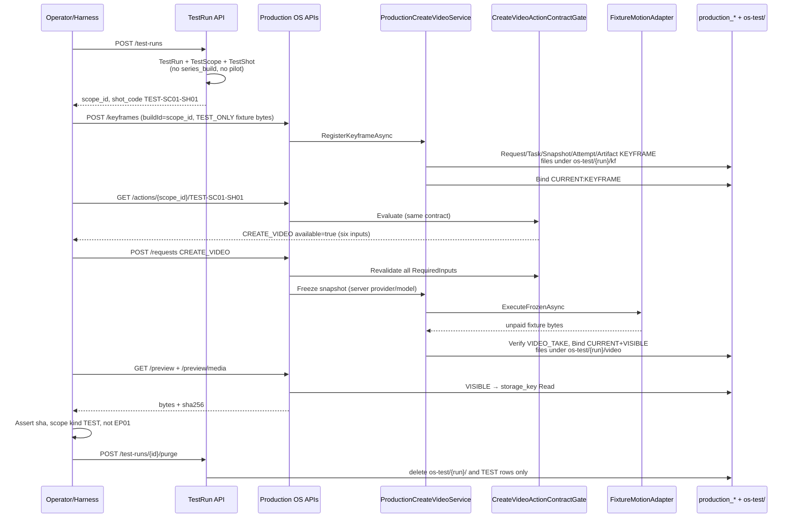

# FAMIXA PRODUCTION OS — CONTROLLED TEST HARNESS ARCHITECTURE V1

Date: 2026-09-17  
Mode: forensic + architecture design only  

Official film left untouched: EP01 6-shot `4ef164d6-10aa-42fd-b3d2-acff9b3d2c7f` (SH01–SH06).  
Official EP99 leave-alone: `77262ec0-74ad-459d-9128-f09bb553a5dd`.

This pass did **not** implement, migrate, write the database, generate an image, call a provider, run a fixture, import a keyframe, edit EP01, or change UI.

---

## Final verdict

**PASS** (architecture / forensic)

A Test Harness can exist without minting a user-facing `series_build` and without a second execution engine.

Proposed identity:

| Concept | Proposed name | Role |
|---|---|---|
| Test run | `TestRun` (`test_run_id`) | Purge root. Owns one or more test scopes and a file prefix. |
| Test scope | `TestScope` (`scope_id`) | The UUID that occupies `ProductionScope.BuildId`. **Not** a `series_build` row. |
| Test shot | `TestShot` (`shot_code`) | OS shot identity on that scope. Suggested code `TEST-SC01-SH01`. |

`ProductionScope(BuildId, EpisodeCode, SceneCode, ShotCode)` stays. Only the **meaning of `BuildId`** changes: it becomes a **scope anchor id** (`FILM` | `TEST`), not “must be `series_build.id`”.

CREATE_VIDEO still runs:

`ProductionCreateVideoService` → `ProductionExecutionService` → `CreateVideoActionContractGate` → `ProductionWorkExecutionEngine` → `IMotionExecutionAdapter` (`FixtureMotionAdapter` unpaid).

No `TestCreateVideoService`. No `TestArtifactService`. No `TestBindingService`.

---

## 1. Problem (current facts)

Production OS persistence (`migrations/368`, `369`) keys work rows by `build_id`:

| Table | `build_id` FK |
|---|---|
| `pack_content.production_requests` | `series_build(id) ON DELETE RESTRICT` |
| `pack_content.production_tasks` | `series_build(id) ON DELETE RESTRICT` |
| `pack_content.production_bindings` | `series_build(id) ON DELETE RESTRICT` |
| `pack_content.production_film_assemblies` | `series_build(id) ON DELETE RESTRICT` |
| `pack_content.production_film_assembly_shots` | `series_build(id) ON DELETE RESTRICT` |

In-memory regressions (`InMemoryProductionWorkStore`) already execute the same engine **without** that FK. Live Postgres cannot.

`series_build` is a user film snapshot (`graph_json`, title, shot counts).  
`PUT /api/content/series/builds` → `ContentSeriesPilotService.UpsertBuildAsync` **always** calls `SetSeriesPilotActiveBuildAsync(seriesCode, row.Id)`. That writes `pack_content.series_pilot.active_build_id`.  
`GET /api/content/series/builds?code=FAMIXA` lists **every** `series_build` for that `series_code` — there is no TEST filter.

Therefore: minting a `series_build` to “get a build_id” makes a Film Studio row and can displace official EP01 as the active FAMIXA pilot.

`DELETE /series/builds/{id}` is blocked after any `production_*` row (`ON DELETE RESTRICT`). There is no Production OS purge API.

---

## 2. Existing domain audit

### 2.1 Records the engine already uses

| Entity | Identity | Scope fields | Notes |
|---|---|---|---|
| `ProductionRequest` | `request_id` | `ProductionScope` | Action + idempotency. FK parent request RESTRICT |
| `ProductionTask` | `task_id` | same scope | Provider/model live on the task after freeze |
| `ProductionTaskInputSnapshot` | `snapshot_id` | via task | **DELETE/mutate blocked** by `fn_prod_snapshot_immutable` |
| `ProductionAttempt` | `attempt_id` | via task | Unique `(provider_id, provider_job_id)` when job id set |
| `ProductionArtifact` | `artifact_id` | via task | **DELETE blocked**; verified bytes immutable |
| `ProductionBinding` | `binding_id` | `build_id` + `shot_code` + `role` | One active row per `(build, shot, role)` |
| `ProductionTaskEvent` | `event_id` | shot_code on event | **DELETE/UPDATE blocked** by `fn_prod_event_immutable` |

`ProductionScope` is four fields only. There is **no** kind, no test flag, no `test_run_id`.

### 2.2 What must change vs what must not

| Layer | Must change to support a test scope | Must not change |
|---|---|---|
| `ProductionScope` shape | Optional: document that `BuildId` is a scope anchor. No extra field required if kind lives in a registry | Shot/Timing/Canon/VA semantics |
| `production_*` FK `build_id → series_build` | **Yes** — this is the blocker | Row shape of Request/Task/Snapshot/Attempt/Artifact/Binding |
| `CreateVideoActionContractGate` | No | Same RequiredInputs |
| `ProductionCreateVideoService` / `ProductionExecutionService` / `ProductionWorkExecutionEngine` | No new test twin. May accept a **storage policy** + **kind guard** | Action IDs, freeze, verify, bind |
| `FixtureMotionAdapter` | No | Still unpaid HOW |
| `IProductionArtifactFileStore` | Folder policy so TEST files are not `os/` / `os-kf/` | Interface stays Write/Read |
| `series_build` / `series_pilot` | **Must not** be the test identity | Official EP01 / EP99 rows |
| Film Studio UI | **Must not** list test scopes | CTA / GET `/actions` obedience |
| Immutable snapshot/event/artifact triggers | **Purge path must be designed around them** | Production archaeology stays locked |

### 2.3 Isolation that already exists (same-shot, not FILM/TEST)

`BindAsync` always writes `(task.Scope.BuildId, task.Scope.ShotCode)`. The caller cannot aim an artifact at another shot.

`ResolveVisiblePreviewAsync` and assembly refuse `CROSS_SHOT_FORBIDDEN` when the artifact’s owning task scope ≠ requested `(buildId, shotCode)`.

`CreateVideoActionContractGate` requires `CURRENT:KEYFRAME` on the **requested** scope; a foreign `keyframeArtifactId` is `INPUT_MUTATED`.

These prevent **cross-shot** steal. They do **not** yet know FILM vs TEST. If a harness reused official `4ef164d6-…` plus a new `shot_code`, OS rows would land on the official build. That is the contamination to design out.

### 2.4 File store today

`ProductionArtifactFileStore` → `KitVideoVideoStore.PersistNamed` under `App_Data/kit-video-i2v/{folder}/{fileId}`.

| Write site | Folder | Used for |
|---|---|---|
| `RegisterKeyframeAsync` | `os-kf` | KEYFRAME bytes (stored as named files; extension is store-default `.mp4` even for PNG) |
| `CreateVideoAsync` | `os` | VIDEO_TAKE fixture bytes |

No TEST prefix. Purge-by-folder of `os/` or `os-kf/` would be a production incident.

### 2.5 Preview today

`GET /api/content/production/shots/{buildId}/{shotCode}/preview`  
→ `VISIBLE` binding → artifact `storage_key` → `GET .../preview/media` reads that key.

No legacy `previewUrl` / `takeUrl` resolver on this path (after Production OS cutover). Test preview must keep this path.

---

## 3. Hard invariants (design rules)

| ID | Rule | How the proposed model holds it |
|---|---|---|
| A | Not in Film Studio production list | No `series_build` row. `ListBuilds(FAMIXA)` cannot see the scope |
| B | Not active FAMIXA pilot | Never call `PUT /series/builds` / `SetSeriesPilotActiveBuildAsync` |
| C | No Canon change | Harness does not write character Canon tables |
| D | No Visual Authority change | Harness does not write VA |
| E | No official `series_build` change | Official ids are refuse-lists on TestRun create |
| F | Test artifact ↛ Production shot | Kind + scope_id check on bind / CREATE_VIDEO / preview / assembly |
| G | Production artifact ↛ Test shot | Same |
| H | Test rows purgeable | `purge(test_run_id)` only deletes `kind=TEST` members |
| I | Test files purgeable | Only `os-test/{test_run_id}/` |
| J | Same execution engine | Same services; identity + storage policy + kind guard only |

Refuse-list (never a TestScope `scope_id`, never written by harness):

- `4ef164d6-10aa-42fd-b3d2-acff9b3d2c7f` (official EP01)
- `77262ec0-74ad-459d-9128-f09bb553a5dd` (official EP99)
- `fd760913-0eb8-46a5-b6eb-ec2990a4b0d0`
- `fca0c122-797e-4356-9bd1-2a70daac1ed4`

---

## 4. Options (factual trade-offs — no ranking)

### OPTION A — TestScope has a build identity that is **not** `series_build`

**Idea:** `ProductionScope.BuildId` is a UUID that is **not** inserted into `series_build`. FK `production_*.build_id → series_build` is dropped or retargeted.

| Axis | Fact |
|---|---|
| DB impact | New optional registry, **or** bare UUID. Must rewrite five FKs from 368 |
| FK impact | High. Existing official OS rows (`build_id` = EP01 uuid) must still resolve. Backfill required: those ids remain valid anchors |
| API impact | Test-run create returns a `scope_id`. Existing `/keyframes` `/requests` `/actions` `/preview` can keep `buildId` = `scope_id` |
| UI impact | None if no `series_build` row. Studio list unchanged |
| Isolation | Strong vs Film Studio / pilot. Weak if any UUID is accepted — a typo of EP01 writes onto official film |
| Purge | Possible by `scope_id` list **if** membership is recorded. Bare UUID without a TestRun table makes “what is test?” a guess |
| Security | Must refuse official ids. Kind should be stored, not inferred from “not in series_build” |
| Migration complexity | Medium–high (FK retarget + backfill FILM anchors for existing `series_build` ids that already have `production_*`) |
| Contamination risk | Low for Studio/pilot. Medium if official UUID is passed as `buildId` on existing production APIs |
| Same execution engine | Yes. `BuildId` stays `Guid`. In-memory store already works this way |

### OPTION B — Quarantined `series_build` with explicit TEST type

**Idea:** Insert a `series_build` with `kind=TEST` or `series_code` other than `FAMIXA`, hide it from `ListBuilds`, skip active-pilot on upsert.

| Axis | Fact |
|---|---|
| DB impact | Column or convention on `series_build`. `production_*` FKs unchanged |
| FK impact | None on 368. `ON DELETE RESTRICT` remains — cannot drop the film row until OS rows are gone |
| API impact | `ListBuilds` and `UpsertBuildAsync` **must** change. Today they have no kind and upsert **always** sets `active_build_id` |
| UI impact | Zero only if **every** list/get/nav path filters TEST. One missed query shows a fake film |
| Isolation | Policy isolation, same table as user films. `graph_json` would be a decoy film document |
| Purge | Must purge `production_*` first, then `DELETE series_build`. Immutable triggers still block naive DELETE of snapshots/events/artifacts |
| Security | Easy to regress: a future `ListBuilds` caller, report, or “latest build” job treats TEST as FAMIXA |
| Migration complexity | Low schema, **high behavioral risk** (pilot + studio filters) |
| Contamination risk | Highest of the three. Same table as official EP01. Pilot write is one forgotten `if` |
| Same execution engine | Yes — `build_id` still points at `series_build` |

### OPTION C — Separate `ProductionTestScope` table/entity (and optionally clone `production_*`)

**Idea A (metadata only):** `production_test_run` / `production_test_scope` hold harness identity. Execution still uses `production_*` with `build_id` = `test_scope.scope_id`. Requires Option A’s FK change.

**Idea B (clone tables):** `production_test_requests` … separate physical tables, `ON DELETE CASCADE` from `test_run_id`.

| Axis | Fact |
|---|---|
| DB impact | Idea A: small metadata + FK retarget. Idea B: full table clone + dual migrations forever |
| FK impact | Idea A: same as A. Idea B: test tables do not touch `series_build`; film FKs unchanged |
| API impact | Dedicated `/production/test-runs` for create/purge. Execution can still be `/keyframes` + `/requests` with test `scope_id`, or wrappers that call the same services |
| UI impact | None if Film Studio never queries test tables |
| Isolation | Idea B strongest (physical). Idea A strong if kind is on the anchor |
| Purge | Idea B: `DELETE test_run` cascades. Idea A: needs a guarded purge (see §7) because of immutable triggers on shared tables |
| Security | Idea B: cross-table bind is impossible unless code reads both. Idea A: needs kind guards |
| Migration complexity | Idea A medium. Idea B high (two schemas, two repositories, lockstep columns) |
| Contamination risk | Idea B lowest **if** nobody implements a second engine that “simplifies” tests. Idea A low with refuse-list + kind |
| Same execution engine | Idea A: yes, one `IProductionWorkStore`. Idea B: yes **only if** the same engine is pointed at a second store mapping. A `TestCreateVideoService` would violate invariant J |

---

## 5. Proposed model (identity / scope / storage / API / purge / security / execution)

This is the model that satisfies the ten exit criteria. It is a **composition**: Option A identity (not a `series_build`) + Option C metadata (`TestRun` / `TestScope` / `TestShot`) + shared `production_*` execution tables. It is not a score against A/B/C.

### 5.1 Identity

```
production_scope_anchor (
  scope_id        UUID PRIMARY KEY,          -- ProductionScope.BuildId
  kind            VARCHAR NOT NULL,          -- 'FILM' | 'TEST'
  series_build_id UUID NULL                  -- FILM only; REFERENCES series_build(id)
                  REFERENCES pack_content.series_build (id),
  test_run_id     UUID NULL,                 -- TEST only
  created_at      TIMESTAMPTZ NOT NULL
  CHECK (kind IN ('FILM', 'TEST'))
  CHECK (kind <> 'FILM' OR series_build_id IS NOT NULL)
  CHECK (kind <> 'TEST' OR test_run_id IS NOT NULL)
  CHECK (kind <> 'TEST' OR series_build_id IS NULL)
)

production_test_run (
  test_run_id     UUID PRIMARY KEY,
  created_at      TIMESTAMPTZ NOT NULL,
  created_by      VARCHAR NOT NULL,
  status          VARCHAR NOT NULL,          -- OPEN | PURGED
  storage_prefix  VARCHAR NOT NULL           -- 'os-test/{test_run_id}'
)

production_test_scope (
  scope_id        UUID PRIMARY KEY REFERENCES production_scope_anchor(scope_id),
  test_run_id     UUID NOT NULL REFERENCES production_test_run(test_run_id),
  episode_code    VARCHAR NOT NULL,          -- e.g. TEST
  scene_code      VARCHAR NOT NULL           -- e.g. SC01
)

production_test_shot (
  test_shot_id    UUID PRIMARY KEY,
  scope_id        UUID NOT NULL REFERENCES production_test_scope(scope_id),
  shot_code       VARCHAR(80) NOT NULL,      -- e.g. TEST-SC01-SH01
  UNIQUE (scope_id, shot_code)
)
```

FILM backfill (implementation-phase migration, not this pass): for every existing `series_build.id` that already appears (or may appear) in `production_*`, insert `scope_anchor(scope_id = series_build.id, kind = FILM, series_build_id = series_build.id)`. Official EP01/EP99 ids stay FILM. No `graph_json` rewrite. No Canon/VA write.

Then:

```
production_requests.build_id  → production_scope_anchor(scope_id)
production_tasks.build_id     → production_scope_anchor(scope_id)
production_bindings.build_id  → production_scope_anchor(scope_id)
production_film_assemblies.build_id → production_scope_anchor(scope_id)
production_film_assembly_shots.build_id → production_scope_anchor(scope_id)
```

`series_build` remains the film document. It is no longer the only legal OS parent.

### 5.2 Scope

Harness creates:

1. `TestRun` (OPEN, storage prefix `os-test/{test_run_id}`)
2. `TestScope` with a **new** `scope_id` (never an official uuid)
3. `TestShot` `TEST-SC01-SH01`

Engine receives:

`ProductionScope(scope_id, "TEST", "SC01", "TEST-SC01-SH01")`

CREATE_VIDEO RequiredInputs unchanged. GET `/actions` uses `CreateVideoActionContractGate` with that scope. No readiness bypass.

### 5.3 Storage

`IProductionArtifactFileStore` stays Write/Read.

A **storage policy** (not a second service) chooses the folder:

| Kind | Keyframe folder | Video folder |
|---|---|---|
| FILM | `os-kf` (current) | `os` (current) |
| TEST | `os-test/{test_run_id}/kf` | `os-test/{test_run_id}/video` |

`ProductionCreateVideoService` must not contain `if (test) { ... }` beyond asking the policy for a folder. Policy input is the scope anchor kind + `test_run_id`.

Preview media reads `artifact.StorageKey` only (VISIBLE path). TEST keys never live under `os/` or `os-kf/`.

### 5.4 API

Harness-only (new, implementation phase):

| Method | Path | Effect |
|---|---|---|
| POST | `/api/content/production/test-runs` | Create TestRun + default TestScope + TestShot. **Does not** touch `series_build` / `series_pilot` |
| GET | `/api/content/production/test-runs/{testRunId}` | Status, scope_id, shot_code, storage prefix |
| POST | `/api/content/production/test-runs/{testRunId}/purge` | `purge(TestRun)` |

Same Production OS APIs (existing), `buildId` = test `scope_id`:

| Method | Path | Engine |
|---|---|---|
| POST | `/api/content/production/keyframes` | `RegisterKeyframeAsync` |
| GET | `/api/content/production/shots/{buildId}/{shotCode}/actions` | `CreateVideoActionContractGate` |
| POST | `/api/content/production/requests` | `CreateVideoAsync` |
| GET | `/api/content/production/shots/{buildId}/{shotCode}/preview` | VISIBLE binding |
| GET | `.../preview/media` | file store Read |

Guards on existing production endpoints (implementation phase):

- If `buildId` is unknown to `production_scope_anchor` → reject (fail closed). Today any uuid that is not a `series_build` fails at FK; after FK retarget, unknown ids must not insert.
- If `kind=FILM` and `buildId` is official → current production behavior (unchanged).
- If `kind=TEST` → allow OS writes; Film Studio still cannot list the id.

Film Studio continues to use `/api/content/series/builds` only. No UI work in this phase; none required for the harness if operators call the test-run + production OS APIs.

### 5.5 Security

- Auth stays ADMIN + `kit_content` (same as `ContentProductionController`).
- TestRun create refuses official uuids and refuses `series_code` / graph upsert.
- Kind mismatch on bind / evaluate / preview / assembly → `CROSS_SCOPE_FORBIDDEN` (new reason at implementation; do not reuse `CROSS_SHOT_FORBIDDEN` for FILM↔TEST so archaeology is clear).
- `uq_prod_attempt_provider_job` stays. Fixture job ids already include task id. TEST attempts should keep a `test:` prefix on `provider_job_id` **inside the adapter payload policy**, not a second adapter class. `FixtureMotionAdapter` can stay; a thin job-id prefix can live in the existing adapter contract later if collision risk is proven. Until then task-id uniqueness is sufficient; kind guard still blocks late-result apply across scopes (`ApplyLateResultAsync` is per attempt → per task → per scope).
- Purge is ADMIN-only and asserts `kind=TEST` for every row it touches.

### 5.6 Execution (invariant J)

```
RegisterKeyframe / CreateVideo
  → ProductionCreateVideoService
  → ProductionExecutionService.EvaluateCreateVideoAsync
  → CreateVideoActionContractGate
  → ProductionWorkExecutionEngine
       Request → Task → FreezeInput (snapshot) → Attempt
  → IMotionExecutionAdapter.ExecuteFrozenAsync   (FixtureMotionAdapter, IsPaid=false)
  → VerifyArtifact → Bind CURRENT + VISIBLE
  → GET preview from VISIBLE + storage_key
```

Paid adapters remain blocked until fixture CREATE_VIDEO is proven (`IsPaid` throw). The harness’s first live slice is unpaid fixture only.

### 5.7 What “same engine” forbids

Do not add:

- `TestCreateVideoService`
- `TestArtifactService`
- `TestBindingService`
- `if (isTest) skip CreateVideoActionContractGate`
- `if (isTest) skip VerifyArtifact`
- A second `FixtureMotionAdapter` that binds CURRENT itself
- Studio CTA changes to “help” the harness

---

## 6. Test image fixture (strategy only — file not created)

No repository TEST_ONLY still exists today (forensic V1). Docs PNGs are Pharmacy/brand shots and must not be used.

**When an implementation phase adds a file, it must be:**

| Property | Rule |
|---|---|
| Path (proposed) | `testdata/famixa-production-os/TEST_ONLY_keyframe_v1.png` |
| Sidecar | `testdata/famixa-production-os/TEST_ONLY_keyframe_v1.manifest.json` with `sha256`, `mime`, `width`, `height`, `byteLength`, `kind: TEST_ONLY` |
| Ownership | Git / repository. Not App_Data. Not Canon. Not official SH01–SH06 pixels |
| Bytes | Deterministic; length ≥ 32 (OS ingest floor) |
| MIME | `image/png` (or `image/jpeg`) recorded in the manifest |
| Dimensions | Fixed, recorded (e.g. 1280×720). Do not “match” official shot aspect by copying official frames |
| SHA256 | Computed once from those bytes; harness asserts before POST `/keyframes` |
| Usage | Only TestScope register-keyframe. Never written into `series_build.graph_json`, Canon, or VA |
| Name | Must contain `TEST_ONLY` |

This phase does **not** add that file and does **not** compute a SHA.

In-memory regressions may keep UTF-8 `"FAMIXA-KF-…"` seeds; those are not the HTTP fixture still.

---

## 7. Purge design

### 7.1 Why `DELETE` is not a simple cascade

On shared `production_*` tables:

| Object | Trigger / FK |
|---|---|
| `production_task_input_snapshots` | `trg_prod_snapshot_immutable` — **DELETE raises** |
| `production_task_events` | `trg_prod_event_immutable` — **DELETE/UPDATE raises** |
| `production_artifacts` | `trg_prod_artifact_bytes_immutable` — **DELETE raises** |
| All OS FKs | `ON DELETE RESTRICT` |

A generic `DELETE FROM production_requests` will fail. That is correct for FILM archaeology.

### 7.2 `purge(test_run_id)` algorithm (design)

Privileged SQL function or application transaction, **kind-guarded**:

1. Load `TestRun`. If `status=PURGED`, no-op.
2. Collect `scope_id`s for that run. Abort if any anchor `kind <> TEST`.
3. Abort if any `scope_id` is on the official refuse-list.
4. Collect `storage_key`s of artifacts whose owning task `build_id` ∈ those scopes.
5. Abort if any key is not under `os-test/{test_run_id}/`.
6. Delete physical files in that prefix only.
7. Delete OS rows **only for those `build_id`s**, in order, via a function allowed to bypass the three immutable triggers **for TEST scopes only** (predicate: `scope_anchor.kind = 'TEST' AND test_run_id = $1`):
   1. unbind `production_bindings`
   2. `production_film_assembly_shots` / assemblies
   3. `production_task_events`
   4. `production_artifacts`
   5. `production_attempts`
   6. `production_tasks.input_snapshot_id` null, then snapshots
   7. `production_tasks`
   8. `production_requests`
8. Delete `production_test_shot` / `production_test_scope` / `production_scope_anchor` / mark `TestRun` PURGED.

Must **not** delete:

- Any `kind=FILM` row
- Official EP01/EP99 `series_build`
- `os/` or `os-kf/` files
- Canon / VA / `graph_json`

If implementation cannot add a kind-scoped trigger bypass, the alternative is Option C Idea B (clone tables with CASCADE). That is a later decision; this design prefers shared tables + guarded purge so the engine stays on one store.

---

## 8. Cross-scope safety

| Attack | Current engine | Required harness guard |
|---|---|---|
| Test artifact bound onto official SH02 | `BindAsync` writes artifact’s own scope, so it would bind on the **test** shot, not SH02 | Also reject bind/evaluate when request scope kind ≠ artifact task kind |
| Production KEYFRAME id sent on test CREATE_VIDEO | Gate: claimed id must match test `CURRENT:KEYFRAME` → `INPUT_MUTATED` / missing | Keep gate; add kind check |
| Test KEYFRAME id sent on official SH02 CREATE_VIDEO | Same | Keep gate; add kind check |
| GET preview(official build, SH02) serves test VISIBLE | Preview requires owning task scope = path `(buildId, shotCode)` | Official path never sees test bindings (different `build_id`) |
| GET preview(test scope) shown as Studio take | Studio lists `series_build` only | Do not add test ids to ListBuilds |
| Test fixture job id applied to production task | Late apply is per `attempt_id` | Kind check if a cross-table apply API appears |
| Harness uses official `buildId` + `TEST-SC01-SH01` | Would insert `production_*` on EP01 | TestRun create + production APIs refuse mixing official uuid with TEST shot namespace **and** refuse creating TEST kind on official uuid |
| PUT `/series/builds` “for the test” | Sets active pilot | Harness runbook + code: never call this |

New failure token (implementation phase): `CROSS_SCOPE_FORBIDDEN` for FILM↔TEST. Keep `CROSS_SHOT_FORBIDDEN` for same-kind different shot.

---

## 9. Same execution engine + fixture motion + action contract + preview

| Requirement | Design |
|---|---|
| No test twin services | One `IProductionCreateVideoService` / `IProductionExecutionService` / `IProductionWorkStore` (Postgres) |
| Fixture motion | Existing `FixtureMotionAdapter` via `IMotionExecutionAdapter`. Unpaid. No `CreateVideoAsync` special case |
| GET `/actions` | Same `CreateVideoActionContractGate`. TestScope with no KEYFRAME → `MISSING_KEYFRAME` + `missingInputs` |
| Preview | VISIBLE → artifact → `IProductionArtifactFileStore.Read`. No `previewUrl` / IDB / `acceptedTake` |

---

## 10. Sequence (acceptance slice — future implementation)



Assertions (future):

- `series_pilot.active_build_id` unchanged
- `GET /series/builds?code=FAMIXA` row set unchanged
- Official EP01 `production_bindings` row set unchanged
- Fixture SHA256 matches manifest
- CREATE_VIDEO snapshot provider/model = fixture adapter
- After purge: zero TEST rows, zero `os-test/{run}/` files, official files intact

---

## 11. Migration / API impact (identified, not applied)

### Migration (later, `migration-files.content.txt` only)

1. Create `production_scope_anchor`, `production_test_run`, `production_test_scope`, `production_test_shot`.
2. Backfill FILM anchors: `scope_id = series_build.id` for existing builds (including official EP01/EP99). No graph/Canon update.
3. Retarget `production_*` `build_id` FKs to `production_scope_anchor`.
4. Add kind-scoped purge function + trigger exception **only** for `kind=TEST`.
5. Do **not** add TEST rows to `series_build`.

### API (later)

- Add test-run create / get / purge.
- Fail closed on unknown `buildId` after FK retarget.
- Kind guards on bind / evaluate / preview / assembly.
- Storage policy folders.
- **No** Film Studio / CTA change required for the harness to run.

### Risk to official EP01 if migration is done correctly

Backfill uses the same uuids. Existing OS rows keep working. Studio list and active pilot unchanged. Contamination happens only if implementation writes TEST kind onto those uuids or calls `PUT /series/builds`.

---

## 12. Implementation plan (order — do not start in this phase)

1. **Scope anchor + FILM backfill + FK retarget** (no TEST data yet). Smoke: official SH02 GET `/actions` still `MISSING_KEYFRAME`; EP01 bindings unchanged.
2. **TestRun / TestScope / TestShot tables + create API.** Prove `GET /series/builds` and `active_build_id` unchanged.
3. **Storage policy** (`os-test/{runId}/…`). FILM folders stay `os-kf` / `os`.
4. **Kind / refuse-list guards** on evaluate, bind, preview, assembly, keyframe, CREATE_VIDEO.
5. **Repo TEST_ONLY fixture image + manifest** (known SHA/MIME/dimensions). Do not use official frames.
6. **Register fixture KF** via existing `POST /keyframes` on test `scope_id`. No Canon/VA/EP01 writes.
7. **GET `/actions`** must go through `CreateVideoActionContractGate` (already true). Assert specific missing reasons then `available=true`.
8. **POST CREATE_VIDEO** unpaid `FixtureMotionAdapter` only. Verify → bind → VISIBLE preview.
9. **Assertions** (pilot, studio list, official bindings, SHA, provider freeze).
10. **`purge(TestRun)`** + proof official files/rows remain.
11. Only then consider paid adapters. Not part of harness v1.

---

## 13. Exit criteria

| # | Criterion | This report |
|---|---|---|
| 1 | Clear TestScope architecture | Scope anchor `scope_id` + TestRun/TestScope/TestShot |
| 2 | Production/Test isolation | Kind, refuse-list, no `series_build`, separate file prefix |
| 3 | No production `series_build` required to test | FK retarget; TestScope is not a film row |
| 4 | Same Production OS execution path | Same five types; no test twin services |
| 5 | Deterministic image fixture strategy | `testdata/.../TEST_ONLY_keyframe_v1.png` + manifest (file not created) |
| 6 | Deterministic purge strategy | Kind-guarded delete order + `os-test/{run}/` only |
| 7 | Cross-scope binding protection | Existing same-shot checks + FILM↔TEST kind checks |
| 8 | Official EP01 unaffected | Refuse-list; no PUT builds; no graph/Canon/VA |
| 9 | Migration/API impact identified | §11 |
| 10 | Ordered implementation plan | §12 |

---

## Writes / paid calls this pass

| Check | Count |
|---|---|
| DB writes | 0 |
| Migrations applied | 0 |
| Image generation | 0 |
| Provider calls | 0 |
| Fixture runs | 0 |
| Keyframe imports | 0 |
| EP01 / UI edits | 0 |

**PASS** as architecture. Not an implemented harness.
