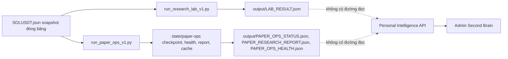
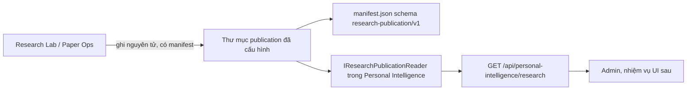

# Second Brain — hợp đồng đọc Research Lab và Paper Ops

Ngày: 2026-10-22. Nhiệm vụ: `SECOND-BRAIN-RESEARCH-READ-API-DESIGN-001`.

Đây là thiết kế. Chưa có API, chưa có migration, chưa deploy. Kết luận cho giai đoạn implementation: **GO có điều kiện**. Điều kiện nằm ở mục 8.

## 1. Những gì đã khảo sát

Personal Intelligence đọc giao dịch qua PostgreSQL schema `pack_personal_intelligence`. Research Lab và Paper Ops không ghi vào schema đó. Frontend admin chỉ biết research lab qua notice tĩnh trong `client/admin/src/modules/second-brain/operator-notices.ts`: ba thí nghiệm không phải nguồn của `GET /api/personal-intelligence/trading/summary`.

### Luồng hiện tại



### File tạo và đọc dữ liệu

| Việc | File |
|---|---|
| So sánh lịch sử ba họ chiến lược, ghi `output/LAB_RESULT.json` và `LAB_REPORT.md` | `research-lab-v1/run_research_lab_v1.py`, `lab.py` |
| Một vòng paper, ghi `state/paper-ops/*` rồi copy ba file ra `output/` | `research-lab-v1/run_paper_ops_v1.py`, `paper_ops.py` |
| Thư mục state | `ops_dir()`: biến `PAPER_OPS_STATE_DIR` nếu có, không thì `research-lab-v1/state/paper-ops` |
| API giao dịch | `TradingDeskController`, route `api/personal-intelligence/trading` |
| Quyền | `PersonalIntelligenceAuthorizationExtensions.cs` |
| Summary hiện tại | `TradingSummaryDto` trong `ITradingDesk.cs` |
| Test HTTP | `tests/KitPlatform.PersonalIntelligence.Tests/RuntimeHttpTests.cs` |

`LAB_RESULT.json` không có `createdAt`, `updatedAt`, hay `schemaVersion`. Các mốc thời gian của paper nằm ở `last_run_at` và `health`. Không dùng giờ sửa file làm mốc nguồn.

Paper Ops ghi JSON qua file tạm rồi `replace`. `LAB_RESULT.json` đang ghi thẳng bằng `write_text`. Bản copy `output/PAPER_*.json` cũng ghi thẳng.

`PAPER_RESEARCH_REPORT.json` có trường `frozen_lab_result` là đường dẫn tương đối trong kho nghiên cứu. API không được trả chuỗi đó.

Ba experiment trong nguồn, không phải danh sách do API chọn: `EXP-TREND-SMA-10-30-V1`, `EXP-BREAKOUT-DONCHIAN-20-V1`, `EXP-REVERSION-RANGE-20-V1`. Trạng thái nguồn ghi trên từng experiment và trên cả báo cáo lab: `approval_status = EXPERIMENT_NOT_APPROVED`, `evidence_status = INSUFFICIENT_EVIDENCE` khi cửa sổ đủ, `performance_claim = NOT_A_PERFORMANCE_CLAIM`, `selected_strategy = null`. Paper health tự tính `OK` hoặc `STALE`: stale khi runner thất bại, không có nến đã xử lý, hoặc tuổi nến lớn hơn hai lần khung thời gian. Tuổi đó là `last_bar_age_ms` do `build_health` ghi.

## 2. Luồng đề xuất



Frontend không mở file và không nhận đường dẫn. Controller không nhận path từ query. Reader chỉ mở các tên file cố định bên trong thư mục do cấu hình máy chủ chỉ định.

Summary giao dịch giữ nguyên. Research không được cộng vào `tradeCount`, `paperExecutionCount`, hay `missingData` của summary.

## 3. So sánh cách lưu

### A. Publication có version, Personal Intelligence chỉ đọc

Lab ghi một thư mục publication. Personal Intelligence đọc đúng thư mục đó qua cấu hình, ví dụ `PersonalIntelligence:ResearchPublication:Root`. Không hard-code đường dẫn máy dev và không hard-code đường dẫn VPS.

Phù hợp với cách lab đang ghi JSON. Không thêm database, queue, hay process mới. Hai bên độc lập: lab có thể đứng im, API trả `MISSING`. Quyền là policy đọc của Personal Intelligence cộng cổng module. Nhất quán dựa vào sha256 trong manifest và ghi nguyên tử. Trên VPS, operator gắn hoặc copy thư mục publication vào đường dẫn trong cấu hình môi trường đó. Mất thư mục thì API trả thiếu dữ liệu, không trả số 0. Chi phí vận hành là một đường dẫn cấu hình và một bước xuất của lab.

### B. Provider nội bộ, frontend không đọc file

Đây là ranh giới module, không phải kho thứ hai. `IResearchPublicationReader` đăng ký trong `PersonalIntelligencePackDependencyInjection`. Controller chỉ gọi interface đó. Một implementation đọc thư mục publication. Không có HTTP service riêng, vì chưa có lý do cho một process mới.

Gọi Python từ API, hoặc để API nhận đường dẫn từ client, bị loại. Cả hai phá ranh giới và mở đọc file tùy ý.

### Phương án chọn

Dùng B làm ranh giới code và A làm kho. Một implementation file, một thư mục cấu hình, không database mới. Không migration.

Kho publication không phải `state/paper-ops` sống. State đó có cache nến và journal. API không đọc journal, cache, `ops.log`, hay snapshot gốc. Publisher sao các sản phẩm đã đóng vào publication.

## 4. Hợp đồng publication

`manifest.json` do lab ghi tại thời điểm xuất thành công. Personal Intelligence không điền `publishedAt` khi manifest thiếu.

| Trường | Nguồn |
|---|---|
| `schemaVersion` | Cố định `research-publication/v1` |
| `publicationId` | Id do publisher sinh, ổn định cho một lần xuất |
| `publishedAt` | Giờ UTC của publisher lúc ghi manifest |
| `labResultSha256` | SHA-256 bytes của `lab/LAB_RESULT.json` |
| `paperStatusSha256` | SHA-256 của `paper/PAPER_OPS_STATUS.json` |
| `paperReportSha256` | SHA-256 của `paper/PAPER_RESEARCH_REPORT.json` |
| `paperHealthSha256` | SHA-256 của `paper/PAPER_OPS_HEALTH.json` |
| `publisher` | `research-lab-v1` |

Layout:

```text
{Root}/manifest.json
{Root}/lab/LAB_RESULT.json
{Root}/paper/PAPER_OPS_STATUS.json
{Root}/paper/PAPER_RESEARCH_REPORT.json
{Root}/paper/PAPER_OPS_HEALTH.json
```

Reader tính lại sha256. Lệch hash thì bản ghi đó là `INCONSISTENT`, không trả phần thân. `schemaVersion` khác `research-publication/v1` thì cả publication là `UNSUPPORTED_VERSION`.

`LAB_RESULT.json` hiện không có mốc thời gian. Khi chưa có manifest, API không bịa `publishedAt` từ giờ file. Trạng thái lab là `PRESENT_UNTIMED` nếu file đọc được và hash không có để đối chiếu, hoặc `MISSING` nếu file không có.

Độ mới paper không tính lại bằng ngưỡng mới. API chuyển nguyên `health`, `last_run_at`, `last_bar_age_ms`, `runner_status`, `cycle_outcome` từ file health và status.

### API

Tất cả GET. Không POST, PUT, PATCH, DELETE. Không tham số đường dẫn.

| Route | Việc |
|---|---|
| `/api/personal-intelligence/research/publication` | Tình trạng publication, hash, lỗi đọc |
| `/api/personal-intelligence/research/experiments` | Danh sách experiment trong lab result |
| `/api/personal-intelligence/research/experiments/{experimentId}` | Một experiment |
| `/api/personal-intelligence/research/paper/status` | Status và health paper |
| `/api/personal-intelligence/research/paper/report` | Báo cáo extension paper |

`experimentId` chỉ được khớp một id đã có trong `experiments` của lab result vừa đọc. Ký tự `/`, `\`, `.` bị từ chối trước khi tìm. Không `Path.Combine` với giá trị người dùng. Không thấy id thì 404 với `{ "code": "NOT_IN_PUBLICATION" }`, không kèm path.

Publication thiếu hoặc hỏng vẫn là HTTP 200 với `availability` rõ. 401 khi chưa đăng nhập. 403 khi module tắt hoặc thiếu quyền, cùng kiểu message module hiện có. Không 500 cho JSON hỏng.

`availability`: `FRESH`, `STALE`, `MISSING`, `UNREADABLE`, `INCONSISTENT`, `UNSUPPORTED_VERSION`, `PRESENT_UNTIMED`.

- `FRESH` chỉ khi paper health nguồn là `OK`.
- `STALE` chỉ khi paper health nguồn là `STALE`.
- `PRESENT_UNTIMED` cho lab result đọc được nhưng nguồn không có mốc thời gian và manifest không có `publishedAt`.
- `MISSING` khi file hoặc manifest bắt buộc không có. Danh sách experiment là mảng rỗng kèm `availability: MISSING`. Không điền số 0 vào net, trade, hay drawdown.
- `UNREADABLE` khi JSON hỏng. `readError.code` là mã ổn định. Message không chứa path, secret, hay nội dung file.

`evidenceStatus` và `approvalStatus` copy từ nguồn. API không đổi `INSUFFICIENT_EVIDENCE` thành đã xác thực, không đổi `EXPERIMENT_NOT_APPROVED`, không tạo tín hiệu mua bán, không xếp hạng theo PnL.

### DTO

Ví dụ dưới đây là **ví dụ hợp đồng**, không phải kết quả nghiên cứu và không phải số đang nằm trong `LAB_RESULT.json`.

```json
{
  "example": true,
  "publication": {
    "availability": "FRESH",
    "schemaVersion": "research-publication/v1",
    "publicationId": "pub-example-001",
    "publishedAt": "2026-01-01T00:00:00+00:00",
    "publisher": "research-lab-v1",
    "objects": [
      {
        "id": "lab-result",
        "kind": "LAB_RESULT",
        "source": "research-lab-v1",
        "availability": "PRESENT_UNTIMED",
        "contentSha256": "abc",
        "publishedAt": null
      }
    ],
    "readError": null
  }
}
```

Experiment detail trả các trường nguồn đã có: `experimentId`, `strategyId`, `strategyVersion`, `family`, `symbol`, `timeframe`, `dataSource`, `snapshotSha256`, `approvalStatus`, `evidenceStatus`, `performanceClaim`, `riskLimitsApproval`, `selectedByPnl`, `parametersChosenOnOutOfSample`, `development`, `outOfSample`, `liveOrders`, `exchangeOrdersSent`. Không trả `events`, journal, hay `gate_if_live_requested` chi tiết nội bộ. `development` và `outOfSample` giữ nguyên khối nguồn, gồm cờ `win_rate_is_performance_evidence` và `profit_factor_is_performance_evidence`.

Paper status trả `runnerStatus`, `cycleOutcome`, `lastRunAt`, `lastProcessedOpenTime`, `lastError` nếu là mã nguồn đã ghi, `health`, `lastBarAgeMs`, `liveOrders`, `exchangeOrdersSent`, `effectiveLiveMode`, `riskLimitsApproval`, `extensionCount`, `extensionSha256`. Bỏ `api_key_present_ignored` và mọi trường khóa.

Paper report trả `reportKind`, cửa sổ extension nếu nguồn có `extension_start_utc` / `extension_end_utc`, từng strategy với `sampleWarning`, `inSampleOutOfSample`, và cờ `exchangeFill`. Thay `frozen_lab_result` bằng `{ "labResult": "SEE_LAB_RESULT_ENDPOINT" }`. Không trả đường dẫn.

Dashboard sau này phải tách bốn việc: số lab, tình trạng paper, sổ giao dịch Personal Intelligence, và dữ liệu kiểm thử trong sổ đó. `TradingSummaryDto.onlyFixtureData` và các count fixture/import/exchange giữ nguyên nghĩa. Research không được vẽ như một lần kiểm chứng đã xong khi `evidenceStatus` không phải trạng thái nguồn dành cho kết luận đã kiểm chứng. Nguồn hiện không có trạng thái đó.

## 5. Quyền

Dùng policy mới `PersonalIntelligenceResearchRead`, permission `personal_intelligence.research.read`.

Người có `personal_intelligence.trading.run` cũng được đọc. Họ đã xem được sổ. Không bắt `trading.approve` và không dùng quyền sàn. ADMIN giữ lối đang dùng ở các policy kia. `[RequirePersonalIntelligenceModule]` gắn trên controller mới.

Chưa cần migration bảng. Permission là claim đã có kiểu của platform. Gán quyền cho role là cấu hình tenant khi bật UI, không phải migration schema. Nếu implementation chọn chỉ reuse `trading.run` và chưa thêm claim mới, vẫn không cần migration. Claim mới là ưu tiên vì research không phải quyền kết nối sàn và không phải quyền duyệt paper.

API không gọi `RiskEngine`, không gọi `DemoPaperExecution`, không mở khóa live. Không có route chạy experiment hay sửa chiến lược.

## 6. Kiểm thử dự kiến

Đặt trong `tests/KitPlatform.PersonalIntelligence.Tests`, fixture thư mục tạm, không đọc kho `research-lab-v1` thật.

- Không token: 401. Module tắt: 403. Có `trading.run` hoặc `research.read`: 200. Có `trading.approve` mà không có quyền đọc: 403.
- Thiếu manifest và thiếu file: `availability = MISSING`, không có số 0 giả.
- Health nguồn `STALE`: `availability = STALE`, vẫn trả `lastRunAt` nếu file status có.
- Lab result không có mốc thời gian: `PRESENT_UNTIMED`, `publishedAt` null.
- JSON cắt dở: `UNREADABLE`, body không chứa path.
- Hash lệch: `INCONSISTENT`, không trả experiment.
- `schemaVersion` lạ: `UNSUPPORTED_VERSION`.
- `experimentId` là `../checkpoint.json` hoặc id không có trong danh sách: 404, không đọc file khác.
- Response không chứa `PAPER_OPS_STATE_DIR`, chữ `:\`, `api_key`, hoặc đường dẫn `frozen_lab_result`.
- `GET /api/personal-intelligence/trading/summary` giữ contract cũ khi reader research lỗi.

Chưa chạy các test này trong nhiệm vụ thiết kế.

## 7. Bước implementation

1. Trong kho research, thêm exporter ghi publication và manifest. Không sửa nội dung `LAB_RESULT.json`, journal lịch sử, snapshot, hay research ledger. Đổi ghi `LAB_RESULT` sang ghi tạm rồi replace. Không cài service và không đụng VPS.
2. Trong Kit Platform, thêm options, reader, DTO, controller GET, đăng ký DI, test thư mục tạm. Không sửa `TradingDeskController` ngoài việc bảo đảm summary không đổi.
3. Nhiệm vụ UI sau mới bỏ notice “chưa nối” khi publication đọc được. Khi `MISSING`, notice giữ nguyên. Không xếp hạng theo PnL.

Không có migration.

## 8. Rủi ro và quyết định

| Rủi ro | Cách chặn |
|---|---|
| API biến mẫu nhỏ thành kết luận | Giữ `evidenceStatus`, `performanceClaim`, `sampleWarning` của nguồn |
| Lộ path hoặc secret | Danh sách trường cho phép, test cấm path |
| Đọc nhầm state sống hoặc snapshot | Reader chỉ mở bốn tên file dưới publication |
| Lab và paper lệch hash | `INCONSISTENT`, không trộn số |
| Ghi `LAB_RESULT` không nguyên tử | Exporter phải replace, reader coi JSON hỏng là `UNREADABLE` |
| Quyền quá rộng | Không dùng approve, không dùng exchange |

**GO có điều kiện** cho một nhiệm vụ implementation riêng.

Điều kiện: chỉ GET, chỉ publication đã cấu hình, không migration, không database mới, không gọi lab lúc request, không đổi RiskEngine hay khóa live, không deploy trong nhiệm vụ đó cho đến khi test ở mục 6 xanh. Nhiệm vụ thiết kế này là **NO-GO** cho việc viết API ngay.

Nếu exporter chưa có, reader vẫn được làm: thiếu publication trả `MISSING`. UI chưa được gọi là đã nối research lab.
